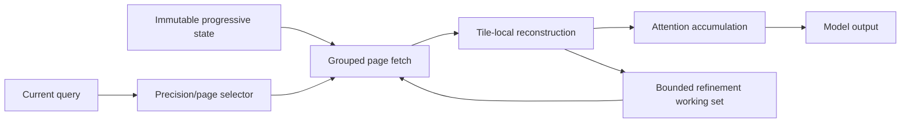

# Proposed packed-KV reader and serving evaluation

Status: proposed. The stock optimized engine is prepared in [E004](../experiments/004-kv-serving/README.md); no new reader is implemented.

## Baseline distinction

E003 stores low-bit KV, then reconstructs full BF16 history before ordinary attention. E004 is intended to evaluate an existing CUDA attention implementation that consumes packed history within attention. These are different engines and quantizers, so cross-engine timing cannot isolate fusion alone.

## Candidate refinement flow

This flow is an idea with substantial prior-art overlap, especially ReadKV and ordinary decoded-page caching. [I001](../ideas/I001-refinement-reuse.md) defines the headroom test before implementing a controller.

## Budgets and interfaces to specify

Packed block format and alignment; scale/zero/codebook storage; group size; page table and queue storage; working-set admission/eviction; accumulation precision; causal mask; residual tail; request ownership and prefix compatibility; transfer, prefill, decode, and rollback boundaries.

The reader must not materialize an uncharged full-precision history as hidden scratch. Actual bytes transferred, selector overhead, temporary memory, and all fallback work must be measured. The decisive metric is useful responses meeting fixed deadlines at matched quality and total resources, not logical payload bits alone.
