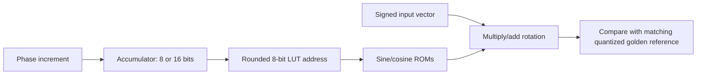

# Implemented phase-rotation datapath

Status: implemented, simulated, synthesized, and tested on the DE2-115. Owning experiment: [E001](../experiments/001-phase-precision/README.md).

Source: [phase_rotator.v](../experiments/001-phase-precision/source/hardware/phase_rotator.v), [test harness](../experiments/001-phase-precision/source/hardware/phase_lab.v), [simulation testbench](../experiments/001-phase-precision/source/hardware/tb_phase_lab.v).

Target: EP4CE115F29C7, nominal 50 MHz. The shared dual-core build reports 218 logic cells / 189 registers for the guarded core and 204 / 170 for the low-precision core, each with one M9K and four 18×18 DSP blocks. These are hierarchy measurements in one shared build, not independent full accelerators. [Hardware summary](../experiments/001-phase-precision/hardware_results.json).

Verification: 1,024 distinct vectors repeated over 10 board runs, zero arithmetic mismatches against each core's own quantized reference, 1,028 controller cycles per run. This does not imply equal model accuracy for the two cores. JTAG external I/O timing is not completely constrained; the fitted estimated Fmax is not a measured board operating frequency.

The block excludes the full SSM recurrence, nonlinear preprocessing, weight movement, model projections, and host integration. Its total-model impact remains unmeasured.
