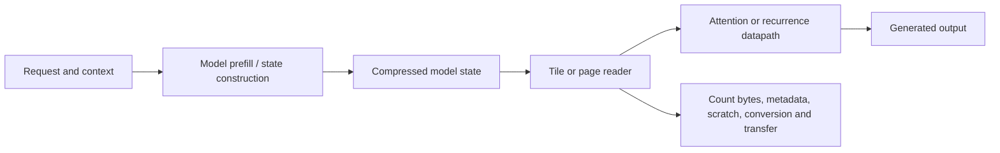

# System scope and boundaries

## Implemented

- **E001 software:** portable FP32 Mamba-3 implementation checked against official reference equations, followed by bounded numerical-precision experiments.
- **E001 FPGA:** phase accumulation, rounded lookup address, quantized sine/cosine lookup, and signed rotation; golden-vector comparisons on a DE2-115.
- **E002:** synthetic updatable-memory algorithms and learned controls.
- **E003:** real-model HF HQQ cache storage, BF16 reconstruction, ordinary attention, and complete-model timing for a small retrieval workload.
- **E004:** pinned stock engine, conversion audit, corrected HTTP/SSE client and an actual single-trial GPU serving pilot.
- **E005:** explicit-address analytical model for progressive read layouts; no hardware reader yet.

## Not implemented or measured

No complete Mamba model executes on the FPGA. No new packed-cache attention kernel or precision-refinement policy exists. GPU serving was measured and eight-slot compressed KV capacity verified; matched-quality goodput improvement is not established. No measured result establishes native FP4 arithmetic acceleration.

## Proposed inference flow

GPU serving and FPGA dataflow prototypes are different evaluation paths. A proposed hybrid system must include host/device transfer, synchronization, and compatibility costs before claiming end-to-end benefit.
