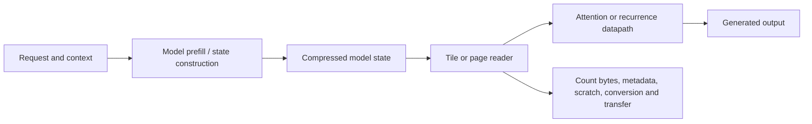

# System scope and boundaries

## Implemented

- **E001 software:** portable FP32 Mamba-3 implementation checked against official reference equations, followed by bounded numerical-precision experiments.
- **E001 FPGA:** phase accumulation, rounded lookup address, quantized sine/cosine lookup, and signed rotation; golden-vector comparisons on a DE2-115.
- **E002:** synthetic updatable-memory algorithms and learned controls.
- **E003:** real-model HF HQQ cache storage, BF16 reconstruction, ordinary attention, and complete-model timing for a small retrieval workload.
- **E004 preparation:** pinned stock engine, checkpoint conversion audit, workload, HTTP/SSE client, and integration checks.

## Not implemented or measured

No complete Mamba model executes on the FPGA. No new packed-cache attention kernel or precision-refinement policy exists. No GPU serving goodput or concurrency improvement has been measured. No measured result establishes native FP4 arithmetic acceleration.

## Proposed inference flow

GPU serving and FPGA dataflow prototypes are different evaluation paths. A proposed hybrid system must include host/device transfer, synchronization, and compatibility costs before claiming end-to-end benefit.
