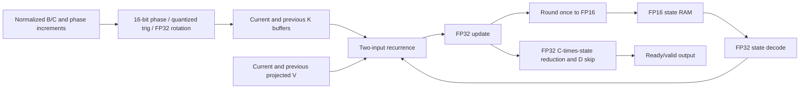

# E001 continuation: a recurrent decode tile

This implementation connects guarded phase rotation, resident FP16 state access,
the original Mamba-3 trapezoidal recurrence, FP32 output reduction, FP16
writeback, and the D skip term. It supports the SISO and rank-4 MIMO layouts.
The result is a verified recurrent-block prototype, with an executable
whole-model software integration boundary. It is not a complete model running
on an FPGA and does not establish an inference speedup.

Read the [implementation report](REPORT.md), [RTL](rtl/mamba3_recurrent_tile.sv),
[seed-locked results](evidence/summary.json), [PASS/FAIL log](evidence/PASS_FAIL.log),
and [whole-model integration smoke](model_results.json).

The isolated [rank-1 rotation-stage experiment](rotation_stage/REPORT.md) adds
one tagged product-register boundary and retains its own regression and timing evidence.

## Data path



For every state coordinate, the implementation evaluates

`S_new = alpha*S_old + beta*sum_r(K_prev[r]*V_prev[r]) + gamma*sum_r(K[r]*V[r])`.

Each output rank then reduces `S_new*C[r]` across N and adds `D*V[r]`.
The output uses the FP32 update before storage rounding. Multiplication and
addition round separately, to nearest with ties to even. This operation order
is explicit; parity with a native kernel using different FMA/reduction ordering
is not claimed.

Unlike E001's original stand-alone rotator, the new input coordinates are FP32,
not Q5.10. The phase accumulator still wraps at 16 bits, the address rounds to
8 bits, and trigonometric values are signed-8-bit integers divided by 127 and
encoded in FP32. Coefficients `alpha/beta/gamma`, normalized/bias-adjusted B/C,
rank-projected V, and quantized phase increments arrive from the host.

## Run

Dependencies are NumPy, Torch/einops for checkpoint work, ModelSim with the
installed Quartus `altera_mf.v` RAM simulation library for RTL, and Quartus Lite
18.1 for the Cyclone IV build. Model assets are external and are
never downloaded automatically. Commands below start in this directory.

```powershell
python export_trace.py --assets C:\path\to\mamba-phase\assets
python regression.py --modelsim-bin C:\intelFPGA\18.1\modelsim_ase\win32aloem
python evaluate_model.py --assets C:\path\to\mamba-phase\assets
python synthesize.py --rank 1
python synthesize.py --rank 4
```

The included traces and exact expected files let the RTL regression run without
model checkpoints, CUDA, or internet access. The ModelSim work library and
primitive vector file are temporary. Quartus databases stay under ignored
`.artifacts/`; vendor reports are retained under `synthesis/`. Synthesis uses
virtual I/O except the physical clock and never programs the board.
Use `--quartus-simlib` to select another installed vendor simulation-library
folder. The RAM primitives are tested with that library, including its actual
one-cycle read behavior; the testbench also rejects read/write address collisions.
Saved QSF files record the applied constraints; see the
[Altera QSF reference](https://resources.altera.com/quartushelp/17.0/reference/glossary/def_qsf.htm)
for assignment-file context.

## Interface and ownership

One instance owns one head and a fixed P-channel slice. Tested geometry is
N=128, P=8, rank=1/4; other parameterizations require their own verification.
The implementation assumes positive P no larger than N and N divisible by 4.

1. Reset discards in-flight work, then clears state, previous K/V, and phase
   over P*N cycles. Wait for `start_ready`.
2. Accept one start command containing FP32 alpha, beta, gamma, D.
3. Stream P*rank projected V values, ordered by P then rank. Input pauses are
   allowed. Keep each valid value stable until ready accepts it.
4. Stream rank*N/2 B/C pairs, ordered by rank then pair. SISO uses adjacent
   coordinates; MIMO pairs i with i+N/2. Only the first N/4 pairs rotate.
   Phase increments apply only on rank zero; other ranks reuse that phase.
5. The core reads and updates each of its P*N state coordinates once. The
   compute pipeline admits one coordinate per cycle. No external DMA is present.
6. The core updates its previous-input cache, then streams P*rank output values
   in P-then-rank order. Output remains stable under backpressure. The last
   accepted output generates `done`; the next command can then start.

State-write signals expose the address, FP32 value, and FP16 code for checking;
the authoritative state RAM is inside the core. This interface does not support
multiple interleaved requests or context swapping yet.

Previous K and projected previous V are FP32 in this prototype. Native Mamba-3
can cache raw V at a different precision and project it when needed. Therefore
the prototype's complete cache accounting differs from the native ledger in
E006. Only the main recurrent state has been halved relative to FP32 storage.

## Remaining complete-decoder work

See the [full-decoder implementation gates](FULL_DECODER_PLAN.md). In particular,
the next milestone is timing closure and a physical transport, followed by
quality-matched complete decode measurements. Replicating this tile alone does
not establish the requested simultaneous-request/deadline improvement.
