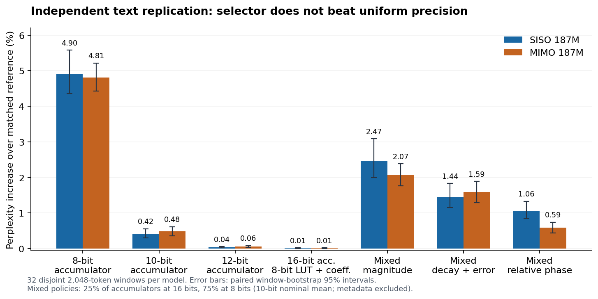
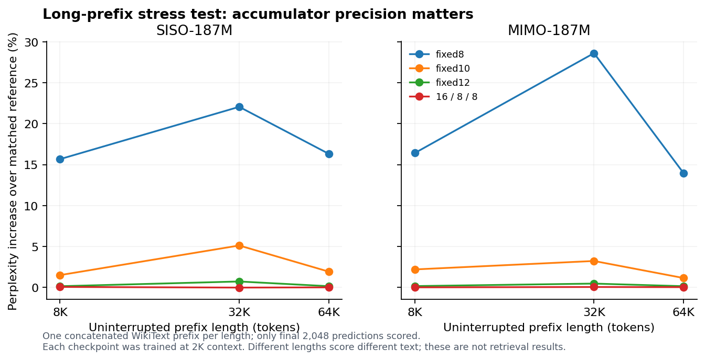
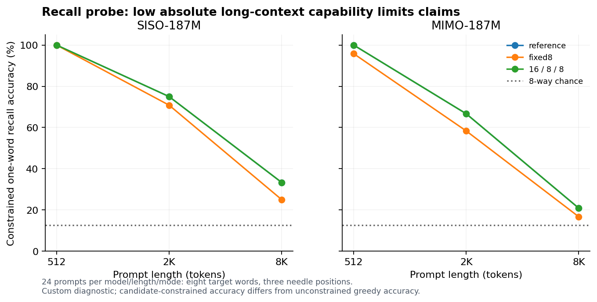
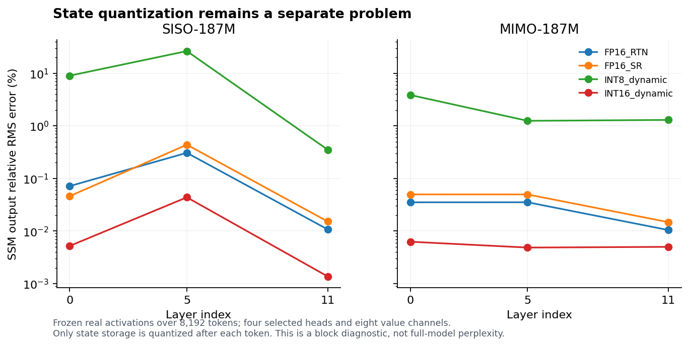

# Mamba-3 phase-precision investigation

Completed October 19, 2026. Pretrained-model numerical experiments and a DE2-115 hardware prototype.

## Findings and research decision

The initial adaptive relative-phase precision policy did **not** beat uniform 10-bit accumulated phase on the independent text replication. It reduced error compared with the two mixed-precision heuristics tested, but that is not a sufficient advantage for the proposed new algorithm. SISO was clearly worse than uniform 10-bit; MIMO's mean was also worse, with a descriptive confidence interval that includes a near tie.

The stronger engineering result is to keep **phase accumulation wider than the angle lookup**. A 16-bit modular accumulator, an 8-bit lookup address, and 8-bit sine/cosine coefficients increased replicated perplexity by only **0.0093% for SISO and 0.0130% for MIMO**. Using an 8-bit accumulator increased it by **4.90% and 4.81%**, respectively. These statements concern phase/rotation precision; weights and recurrent state remained FP32 in the language-model experiments.

I built and ran the corresponding small rotation datapath on the connected DE2-115. Both the 8-bit and 16-bit cores matched independent integer expected values on all 1,024 vectors, repeated ten times. The 16-bit core cost 14 additional logic cells in this dual-core build, with the same multiplier and M9K counts.

**Decision:** stop treating the present adaptive selector as a demonstrated new algorithm. Retain the simple 16/8/8 design as a validated baseline for subsequent Mamba-3 hardware work. This study establishes a useful precision distinction and a working core; it does not establish a publishably novel accelerator or end-to-end FPGA speedup.

## What I did

1. Inspected the available GPUs, software, and connected FPGA interface. Used both RTX 3090s for model experiments and Quartus Prime Lite 18.1 for Cyclone IV synthesis and JTAG access.
2. Downloaded official pretrained Mamba-3 SISO and MIMO 187M checkpoints, pinned upstream reference code, the specified Llama-3.1 tokenizer through a public mirror, and WikiText-2 raw validation/test data. Saved revisions and SHA-256 hashes.
3. Implemented a portable PyTorch evaluator for the full 12-layer networks, including their MLPs, normalization, residual paths, trapezoidal previous-input term, rotation conventions, MIMO projections, and all persistent state objects.
4. Checked the recurrence against the authors' reference functions, checked chunk widths and continuation, checked all model parameter keys, and checked modular fixed-point arithmetic against integer accumulation.
5. Ran exploratory precision sweeps, a separate text replication, long-prefix stress tests, a small recall probe, and frozen-activation state-quantization diagnostics.
6. Implemented a pipelined Verilog phase/rotation core, generated independent expected vectors, simulated it, synthesized/routed it, programmed the FPGA's volatile configuration, and read back ten self-test runs over JTAG.
7. Exported figures, tables, raw numerical outputs, build reports, the bitstream, and reproducible source code.

## Models, data and reference arithmetic

Both models have 12 layers, model width 768, 24 SSM heads, head dimension 64, state dimension 128, and rotary fraction 0.5. MIMO uses interaction rank 4. The checkpoint cards specify training at 2,048-token context. There is no fine-tuning or model retraining in this investigation.

- SISO checkpoint: `state-spaces/mamba3-siso-187m`, revision `6792c27c00f3bb41506db1066dcd1c51bb0f4b02`.
- MIMO checkpoint: `state-spaces/mamba3-mimo-187m`, revision `8fd6e9eb7b795f2e15d7f6353251d0137980c43e`.
- Upstream code revision: `e9594ce1c732d97440f0332fdc43170a2294dbfa`.
- Tokenizer: Llama-3.1 vocabulary, public mirror `NousResearch/Meta-Llama-3.1-8B`, revision `1f47e50cdbe801ad8a5174156ec3a0655108fb9f`. Vocabulary size is 128,256, matching the checkpoints.

The BF16 checkpoint parameters were converted to FP32. Projections, normalization, state arithmetic, and readout used FP32 with TF32 disabled. Ideal phase accumulation used FP64 to isolate the designed fixed-point errors. This reference is validated against the authors' **FP32 equation/reference paths**, not against their native BF16 CUDA kernels. The official optimized kernel stack was not run on Windows/RTX 3090. No native-kernel throughput comparison is claimed.

WikiText rows were joined with two newlines and encoded without automatic special tokens. A BOS token (128000) was prepended to each reset sequence; each input predicts the next token. All token positions, including the first prediction after BOS, enter the reported language-model loss. No train/validation samples entered test loss.

The exploratory sweep used eight 2,048-token windows beginning at test-token positions 0, 4096, ..., 28672 (16,384 predictions per configuration). Calibration used validation tokens 0 through 2046 plus BOS. The independent replication used **32 disjoint 2,048-token windows**, beginning at 32768 + 4096*i for i=0..31 (**65,536 predictions per configuration**). These replication windows do not overlap the exploratory windows. This is a selected-window evaluation, not the canonical full-test WikiText-2 benchmark.

## Correctness evidence

| Check | SISO | MIMO |
| --- | --- | --- |
| Maximum absolute recurrence difference from upstream | 1.19e-06 | 1.91e-06 |
| Relative RMS recurrence difference | 2.57e-07 | 2.36e-07 |
| Full-model split-continuation maximum logit difference | 0 | 6.72e-05 |
| Unused checkpoint parameter keys | None | None |

Continuation checks preserved angle state, recurrent state, previous rotated B/key, and previous x/value. Two tested chunk widths agreed within 2.4e-6 on the small recurrence checks. A constant shared phase offset left the model losses unchanged within rounding, supporting the distinction between absolute coordinate offset and relative write/read phase error. Fixed-point emulation matched explicit modular integer accumulation over 65,536 steps for widths 6, 8, 10, 12, and 16.

## Precisely what was quantized

For each rotary coordinate, the unquantized increment is tanh(angle projection) * dt * pi. A b-bit fixed-point phase uses a circular grid of 2^b points per full turn. Increments are rounded to that grid, accumulated, and wrapped modulo one turn. This models a b-bit modular phase accumulator; it does not mean b-bit weights or b-bit SSM state.

- **fixed8/fixed10/fixed12/fixed16:** rounded phase increments plus a modular accumulator at the named width. Sine/cosine evaluation itself remains FP32.
- **lookup8:** ideal accumulated phase, rounded only when selecting an angle for the trigonometric evaluation. This is a diagnostic control, not a low-precision accumulator.
- **guard16_8:** 16-bit increments/accumulator and an 8-bit rounded angle for lookup.
- **guard16_8_trig8 (16/8/8):** the preceding design plus symmetric signed coefficient quantization, round(127*cos)/127 and round(127*sin)/127. This is the numerical recipe corresponding most closely to the FPGA core.
- **trig6/trig8/trig10:** coefficient quantization alone. These controls isolate coefficient error from phase accumulation.

All rounding is nearest with ties to even. Actual FPGA input x/y values are also 16-bit integers, whereas language-model x/y arithmetic remains FP32. Therefore the board test proves core arithmetic, not bit-identical execution of a full low-precision language model.

The exploratory 16,384-token sweep isolated these sources of error as follows. This table uses the exploratory windows; the larger independent replication is reported separately below.

| Isolated control | SISO perplexity change | MIMO perplexity change |
| --- | --- | --- |
| 6-bit accumulated phase | +50.0418% | +41.5521% |
| 8-bit accumulated phase | +4.3312% | +4.3467% |
| Only lookup angle rounded to 8 bits | +0.0177% | +0.0119% |
| Only coefficients rounded to 8 bits | +0.0015% | +0.0018% |
| Shared constant phase offset | -0.0000% | +0.0000% |

The large difference between quantizing accumulated phase and quantizing only the lookup angle supports spending bits on accumulation first. It does not establish that all other operators can use the same low precision.

## Independent text replication

Lower perplexity is better. Relative changes use the same model and test positions.

| Configuration | SISO perplexity | SISO change | MIMO perplexity | MIMO change |
| --- | --- | --- | --- | --- |
| Reference | 24.58327 | +0.0000% | 24.39153 | +0.0000% |
| 8-bit accumulated phase | 25.78882 | +4.9040% | 25.56453 | +4.8090% |
| 10-bit accumulated phase | 24.68637 | +0.4194% | 24.50872 | +0.4804% |
| 12-bit accumulated phase | 24.59247 | +0.0374% | 24.40544 | +0.0570% |
| 16-bit accumulator / 8-bit lookup angle | 24.58491 | +0.0067% | 24.39262 | +0.0044% |
| 16-bit accumulator / 8-bit lookup / 8-bit coefficients | 24.58555 | +0.0093% | 24.39471 | +0.0130% |
| Mixed 8/16: magnitude | 25.19062 | +2.4706% | 24.89756 | +2.0746% |
| Mixed 8/16: decay + local error | 24.93801 | +1.4430% | 24.77973 | +1.5915% |
| Mixed 8/16: relative-phase score | 24.84487 | +1.0641% | 24.53564 | +0.5908% |

The replicated result favors a simple precision floor. Uniform 12-bit accumulated phase is already close to reference here. The mixed policies use 25% of accumulators at 16 bits and 75% at 8 bits, a nominal mean of 10 bits before selector/layout metadata. Uniform 10-bit is therefore a necessary comparison, not just uniform 8-bit.

### How the selector was constructed

For each layer/head/rotary pair, the proposed score estimated relative phase distortion across lags 1, 4, 16, 64, and 256. It weighted a circular chord-error term by observed B/C pair magnitudes, value magnitude, dt, and decay over the interval. All scores came from validation activations. The top 25% of rotary pairs **within each layer** received 16 bits, and the rest received 8 bits; the allocation was then frozen.

The comparison heuristics used B/C pair magnitude, or local angle-rounding error weighted by a simple decay-persistence factor. The latter is an adaptation inspired by decay-aware allocation, **not a reproduction of DAMP**, which studies different recurrent architectures and state quantization. No tuning followed the independent replication.

The relative-phase score beat these two particular mixed heuristics, but failed the stronger uniform-10 comparison. Its SISO excess NLL over uniform 10 was 0.006400, with window-bootstrap 95% interval [0.004878, 0.008121]. MIMO excess NLL was 0.001098, interval [-0.000055, 0.002282]. The data do not establish a selector advantage on either model. This is a negative result for the initial research hypothesis, not a reason to omit the uniform baseline.

### Uncertainty

| Model | Configuration | Perplexity change | Descriptive 95% interval |
| --- | --- | --- | --- |
| siso-187m | fixed8 | +4.9040% | [+4.3586%, +5.5760%] |
| siso-187m | fixed10 | +0.4194% | [+0.2969%, +0.5588%] |
| siso-187m | guard16_8_trig8 | +0.0093% | [-0.0006%, +0.0189%] |
| siso-187m | mixed_phase_relative | +1.0641% | [+0.8429%, +1.3315%] |
| mimo-187m | fixed8 | +4.8090% | [+4.4321%, +5.2157%] |
| mimo-187m | fixed10 | +0.4804% | [+0.3540%, +0.6128%] |
| mimo-187m | guard16_8_trig8 | +0.0130% | [+0.0064%, +0.0198%] |
| mimo-187m | mixed_phase_relative | +0.5908% | [+0.4404%, +0.7370%] |

Intervals use 20,000 paired resamples of whole windows, seed 20261019. They describe this selected-window sample. Windows may share articles or related text, and comparisons are not corrected for multiplicity; these intervals are not a universal guarantee. A tiny negative change is not evidence that quantization improves the model.

## Long-prefix stress tests

The same initial test prefix was processed without resetting its state, in 2,048-token chunks, to lengths 8K, 32K, and 64K. Only the last 2,048 predictions were scored at each length. These are concatenated WikiText articles, not coherent 64K books, and each length scores different target text. The experiment isolates additional precision degradation relative to a matched reference at that length. It is not evidence of useful 64K recall or a comparison of absolute perplexity across lengths.

| Prefix | SISO fixed8 | SISO fixed10 | SISO fixed12 | SISO 16/8/8 | MIMO fixed8 | MIMO fixed10 | MIMO fixed12 | MIMO 16/8/8 |
| --- | --- | --- | --- | --- | --- | --- | --- | --- |
| 8,192 | +15.664% | +1.493% | +0.134% | +0.047% | +16.411% | +2.187% | +0.149% | -0.004% |
| 32,768 | +22.056% | +5.112% | +0.712% | -0.032% | +28.614% | +3.218% | +0.456% | +0.040% |
| 65,536 | +16.311% | +1.916% | +0.136% | -0.005% | +13.950% | +1.135% | +0.137% | +0.020% |

At 64K, fixed8 increased perplexity by 16.31% and 13.95% on SISO/MIMO. The 16/8/8 recipe changed it by -0.005% and +0.020%. The non-monotonic curves should not be interpreted as recovery at longer contexts: the target passages and native model dynamics differ. Only one prefix was used at each length, so there is no independent long-prefix confidence interval.

## Recall probe

I built a small next-word recall diagnostic using eight single-token target words (apple, river, music, paper, green, horse, water, stone), each inserted at 10%, 50%, or 90% of a WikiText-filled prompt. The needle states the secret word; the suffix asks for it. There are 24 prompts per length/configuration, with lengths 512, 2048, and 8192. The answer is scored both by choosing the highest-logit word among the eight candidates and by unrestricted greedy next-token prediction. Eight-way chance is 12.5%.

This is an authored diagnostic, not an official NIAH or long-context benchmark. Its initial 512-token pilot established that the models could perform the task before expanding the length sweep. The full prompt generator and every case's result are included.

Cells below are **constrained accuracy / unrestricted greedy accuracy**.

| Model | Prompt tokens | Reference | fixed8 | 16/8/8 |
| --- | --- | --- | --- | --- |
| siso-187m | 512 | 100.0% / 95.8% | 100.0% / 75.0% | 100.0% / 95.8% |
| mimo-187m | 512 | 100.0% / 75.0% | 95.8% / 58.3% | 100.0% / 75.0% |
| siso-187m | 2048 | 75.0% / 8.3% | 70.8% / 8.3% | 75.0% / 12.5% |
| mimo-187m | 2048 | 66.7% / 20.8% | 58.3% / 16.7% | 66.7% / 20.8% |
| siso-187m | 8192 | 33.3% / 0.0% | 25.0% / 4.2% | 33.3% / 0.0% |
| mimo-187m | 8192 | 20.8% / 0.0% | 16.7% / 0.0% | 20.8% / 0.0% |

The 16/8/8 recipe matched reference constrained-accuracy counts at all tested lengths for both models. However, the native 187M models had low absolute 8K performance and zero unrestricted greedy accuracy there. The sample is small, and matching aggregate counts need not mean matching every case. I therefore do not claim preserved general long-context retrieval capability.

## Recurrent-state quantization: a separate diagnostic

To avoid confusing phase results with cache compression, I separately replayed frozen real activations from layers 0, 5, and 11 over 8,192 held-out tokens. Each replay included heads 0, 7, 15, and 23, all 128 state coordinates, and value channels 0 through 7. Calibration scales came from the validation trajectory. The recurrence was evaluated directly in a Numba CPU kernel and checked against the PyTorch chunk result; worst relative RMS parity error was below 8e-7.

State was quantized **after every token and before readout**, while previous-key/value buffers remained FP32. Dynamic integer formats used one scale per head/value row across N. Static integer scales used validation maxima. FP16 rounding was emulated including subnormal spacing; the stochastic variant used one fixed reproducible seed per row. Outputs below are **raw SSM output relative RMS errors**, not full-model perplexities, token accuracies, or measured memory savings.

| Model | Layer | FP16 nearest | FP16 stochastic | INT8 dynamic | INT16 dynamic |
| --- | --- | --- | --- | --- | --- |
| siso-187m | 0 | 0.0713% | 0.0459% | 8.9576% | 0.0052% |
| siso-187m | 5 | 0.3062% | 0.4369% | 26.2868% | 0.0437% |
| siso-187m | 11 | 0.0107% | 0.0152% | 0.3518% | 0.0014% |
| mimo-187m | 0 | 0.0351% | 0.0497% | 3.8523% | 0.0063% |
| mimo-187m | 5 | 0.0352% | 0.0496% | 1.2437% | 0.0048% |
| mimo-187m | 11 | 0.0104% | 0.0148% | 1.2922% | 0.0050% |

INT8 dynamic error varied greatly by layer, reaching 26.29% in the selected SISO layer-5 replay. Dynamic INT16 was much more accurate. Static formats sometimes clipped on held-out activations even at 16 bits; a wider integer alone does not fix an inappropriate calibrated range. Stochastic FP16 rounding was not uniformly better in this diagnostic. In one replay, adding phase error reduced an existing INT8 output error, illustrating error cancellation; that is not evidence that deliberately reducing phase precision is beneficial.

The next cache-compression experiment must validate **end-to-end quality** with recurrent feedback. Frozen traces do not include the changes in subsequent layers and input-dependent coefficients caused by quantization.

## DE2-115 implementation and measurements

The user's connected board was accessed through USB-Blaster, JTAG ID 0x020F70DD. Quartus successfully configured the compiled target EP4CE115F29. The project targets EP4CE115F29C7 on the DE2-115, using CLOCK_50 on PIN_Y2 and the board's nominal 50 MHz clock. Only that user I/O pin is used; other unused pins are configured as tri-stated inputs. The FPGA was programmed through a `.sof` into **volatile configuration**, not flash. It currently holds the completed test design.

The prototype has a modular accumulator, rounded lookup address, 256-entry sine/cosine tables with signed 8-bit coefficients, four signed 16x8 multiplications, and 25-bit product sums. Outputs remain at coefficient scale 127; downstream division/requantization is outside the core. The pipeline accepts one pair per cycle. Nonlinear angle preprocessing, vector normalization, B/C generation, and SSM state updates are outside the hardware experiment.

I generated 1,024 expected vectors independently in Python: 16 signed-data/wrap/ties-even cases and 1,008 remaining vectors derived from validation activations of the two pretrained models. Each core was compared against its **own** expected quantized arithmetic, not against the other core or an unquantized ideal. Both implementations can therefore be functionally correct while having different language-model accuracy.

ModelSim 10.5b compiled the RTL with zero errors/warnings and reported 1,024 completed vectors, zero mismatches for both cores, and 1,028 controller cycles. After synthesis, the FPGA repeated that result over ten JTAG-controlled resets/runs: **20,480 checked core results in total, from 1,024 distinct vectors repeated ten times per core**. Final accumulated phase codes matched Python as well (40479 and 181).

| Per-core fitted resources | 8-bit accumulator | 16-bit accumulator |
| --- | --- | --- |
| Logic cells | 204 | 218 |
| Dedicated logic registers | 170 | 189 |
| M9K blocks | 1 | 1 |
| Stored sine/cosine bits | 4096 | 4096 |
| 18x18 multiplier units | 4 | 4 |

The wider accumulator added **14 logic cells (+6.9% of this small core) and 19 registers**, with no increase in memory blocks or multipliers. These are hierarchy allocations from **one dual-core fitted design**, with possible cross-hierarchy optimization; they are not isolated standalone builds. The complete test harness, including both cores, expected-value/vector ROMs, comparison logic, and JTAG instrumentation, used 1,397 logic elements, 22 M9Ks, and eight 18x18 multiplier units.

At nominal 50 MHz, the on-chip count of 1,028 cycles corresponds to 20.56 microseconds per 1,024-vector run, including pipeline/controller overhead. The core's steady-state acceptance rate is one rotation pair per cycle (nominal 50 million pairs/s). This is a clock-derived kernel rate, not externally timed maximum throughput, JTAG-host throughput, model tokens/s, or a GPU speedup.

TimeQuest estimated CLOCK_50 Fmax at **82.29 MHz** in the slow 85C model. The 50 MHz constraint had **+7.848 ns worst setup slack** and positive hold slack across reported corners. Reserved JTAG TDI/TMS input and TDO output delays remain unconstrained; the reports explicitly state that the design is not fully constrained at its external JTAG ports. No unconstrained clocks were reported. Thus the core clock target passed, but this is not a complete production external-interface timing sign-off. The full compilation had zero errors and 21 warnings, retained in the build reports.

The FPGA does **not** run either full pretrained model. Their uncompressed FP32 SSM cache alone is 9 MiB across 12 layers, versus approximately 0.475 MiB of embedded RAM on this board. The actual BF16 checkpoint files are also larger than its 128 MB SDRAM. A full-model accelerator would need a separate compression, off-chip-memory, and scheduling design. Cyclone IV uses M9K blocks, not the BRAM/URAM terminology specific to other FPGA families.

## What is new, and what is not established

The original relative-phase selector remains an unproven candidate and failed the strongest baseline in this pilot. The replacement engineering design must **not** be described as a new invention: separate accumulator, angular, and magnitude precision are longstanding numerically controlled oscillator design choices, documented by Altera. A further search also found public `mamba-rs` implementation notes describing wider Mamba-3 angle accumulation before lower-precision trigonometric evaluation.

The useful output here is the measured Mamba-3-specific trade-off, the negative selector result, and the matched numerical/hardware baseline. No exact prior version of this entire experimental package was found, but absence of an exact matching package is not proof of a research contribution. I cannot currently certify a novel publishable algorithm or a first Mamba-3 FPGA implementation.

## Recommended next investigation

1. Use 16/8/8 as the control configuration. Re-test it on at least one larger checkpoint and independent long-document data before choosing a permanent precision floor. The present 187M results do not establish model-size or domain generality.
2. Prioritize recurrent-state storage and dataflow over a more elaborate angle selector. The core now supplies a concrete, inexpensive rotation primitive, while state quantization showed substantial layer sensitivity.
3. For a hardware contribution, integrate this primitive into one streamed Mamba-3 head/tile with explicit state and previous-input buffers. Compare identical-precision schedules for bytes moved, stalls, M9K/DSP use, and routed timing. Do not claim whole-model benefit from core throughput alone.
4. Only revisit adaptive phase allocation if a validation-only revised method beats uniform precision at equal **implemented** hardware cost. The current result does not justify increasing selector complexity.

## Limitations and reproducibility

This is a completed initial investigation, not a trained new model or publication-ready full accelerator. Its main limitations are two small pretrained checkpoints, one calibration window, selected WikiText test windows, one prefix per long length, a custom 24-case-per-length recall probe, and selected frozen-state channels. The models were not evaluated with their native optimized GPU kernels. There is no RTL for full-model inference, no power measurement, no thermal study, and no comparison against a CORDIC or commercial NCO implementation at matched quality.

The source bundle contains the portable evaluator, exact experiment definitions, calibration policies, raw losses and masks, model/source hashes, plotting/report scripts, RTL, testbench, vectors, expected values, board-run records, fitted resource/timing reports, and the tested `.sof`. Large checkpoint files and the local Python environment are excluded; the fetch script pins model/code/tokenizer revisions. Dataset hashes are recorded; the fetch script currently resolves the dataset's main branch, so a future mismatch must be checked against the saved manifest before comparison. Runtime versions are frozen in `requirements-lock.txt`.

Native Windows tools required unsandboxed execution for JTAG and simulation. WSL was unavailable in this session, and the bundled Python initially lacked PyTorch; dependencies were installed in an isolated workspace environment. No changes to the global Python environment or FPGA flash were required.

## Primary sources and implementation neighbors

- [Official Mamba-3 paper](https://arxiv.org/html/2603.15569v1): recurrence, rotary equivalence, and MIMO architecture.
- [Official pinned source tree](https://github.com/state-spaces/mamba/tree/e9594ce1c732d97440f0332fdc43170a2294dbfa): reference functions, model graph, and state layout.
- [Official SISO checkpoint](https://huggingface.co/state-spaces/mamba3-siso-187m) and [official MIMO checkpoint](https://huggingface.co/state-spaces/mamba3-mimo-187m): weights, configs, and tokenizer specification.
- [WikiText dataset](https://huggingface.co/datasets/Salesforce/wikitext): validation/test text.
- [Understanding Mamba-3 Through Oscillatory Dynamics](https://arxiv.org/html/2610.13341v1): prior phase analysis and write/read consistency.
- [DAMP](https://arxiv.org/html/2608.27513v1) and [Quamba2](https://arxiv.org/html/2503.22879v2): related recurrent-state quantization work; neither is reproduced as an official full-method baseline here.
- [Altera NCO design example](https://docs.altera.com/api/khub/documents/5JfB~gKSGSuKsRwpn7oV1A/content) and [NCO ROM architecture](https://docs.altera.com/r/docs/683406/24.3/nco-ip-user-guide/large-rom-architecture?contentId=7mD1~mbJJ5Z6Bs9~A_mNRQ): established separation of accumulator/angular/magnitude precision.
- [Public mamba-rs accumulation notes](https://docs.rs/crate/mamba-rs/0.3.1/source/CHANGELOG.md): existing implementation discussion of accumulation precision.
- [Terasic DE2-115 specifications](https://www.terasic.com.tw/cgi-bin/page/archive.pl?CategoryNo=205&Language=English&No=502&PartNo=2) and [board manual](https://www.terasic.com.tw/wiki/images/f/ff/DE2_115_User_manual_2013.pdf): target FPGA, resources, and 50 MHz pin assignment.
