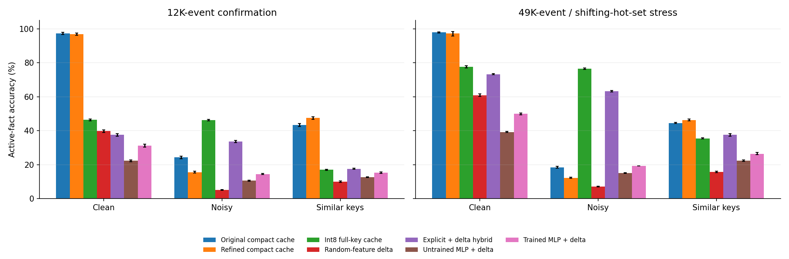
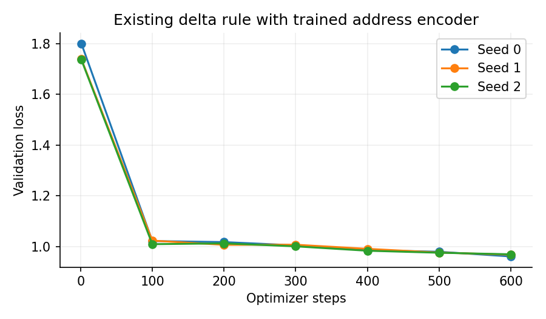
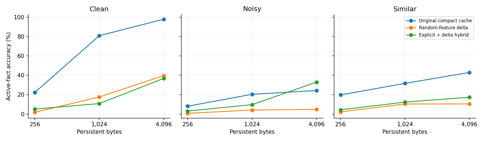

# Updatable memory under a strict storage budget: first investigation

October 19, 2026. Status: completed synthetic baseline study and three learned-baseline runs. This is research groundwork, not a novel architecture or a claim of superiority over Mamba-3.

**Decision:** the trained recurrent baseline improves over its own untrained initialization but does not establish an advantage over compact explicit memory. Keep the benchmark and controls; do not scale this baseline or build FPGA hardware on the strength of these results. The potential next question is how a memory should edit a binding when identity evidence is uncertain, with representation quality held constant across competitors.

## What we actually did

Built a reproducible online SET/DELETE/QUERY task, implemented compact explicit memories and recurrent update controls, trained three small address encoders through an existing delta recurrence, and compared frozen configurations on independent streams. The central question is whether a learned recurrent memory earns its storage cost against ordinary explicit storage, especially when an observation does not provide a perfect entity ID.

The original analytic screen used three budgets (256, 1,024, and 4,096 bytes), eight main-test stream seeds per regime, and four longer stress seeds per regime. Its 36 unique held-out streams contained 884,736 events, reused across budgets and methods. The learned baseline trained on 600 batches of 24 sequences of 256 events for each of three initialization seeds: **11,059,200 training events in total**. These are synthetic events, not language tokens.

We then ran a fresh confirmation after strengthening the explicit control. It has another 36 streams and 884,736 events, shared by every compared method. All three neural initializations are evaluated on each confirmation stream. Calibration, training, validation, original test, learned-model final test, and confirmation seeds are documented separately in the protocols and source.

## First conclusion: exact symbolic IDs make this an ordinary storage problem

For 128 known entity IDs and 16 values plus ABSENT, a direct-address uint8 table occupies **128 bytes** and answers **100%** of queries in the analytic screen. Five-bit packing would reduce the payload to 80 bytes. This table receives exact IDs and is therefore a stronger-interface diagnostic, not a fair perceptual-key competitor. It demonstrates why beating a weak recurrent baseline on symbolic overwrites would not establish a useful new capability.

A standard counting argument sharpens this: there are 17^128 possible current worlds. Exact answers for every entity in every possible world require at least ceil(log2(17^128)) = **524 bits**, rounded to **66 bytes** of addressable storage, assuming fixed weights and no other saved history. A base-17 integer encoding attains that byte count; we implemented it and verified 100% accuracy on all 36 original test/stress streams. It uses a 66-byte payload and shared fixed powers of 17, with big-integer arithmetic as scratch. This is a conventional coding control, not a new theorem or efficient accelerator. It exposes how close ordinary symbolic storage can get to the information bound; the bound does not directly apply to uncertain perceptual identities or distribution-dependent approximate recall.

## The harder interface

Every entity instead has a randomly sampled 64D unit-vector prototype. Each write, deletion, and query receives a fresh observed vector. Models never receive the evaluator's entity index or prototype lookup table. Values are independently sampled per stream and SET changes the old binding; no model can answer from its frozen weights alone.

- **Clean:** independent prototypes, no observation noise.
- **Noisy:** independent prototypes with Gaussian noise of standard deviation 0.10 per coordinate, followed by normalization. This is substantial relative to the unit prototype norm.
- **Similar:** eight entities per cluster, with prototypes formed from 0.90 times a shared cluster center plus 0.44 times an independent direction, normalized; observation noise 0.05 per coordinate.

After initializing all entities through ordinary observed SET operations, events are 60% SET, 10% DELETE, and 30% QUERY. The main evaluation has 128 entities and 12,288 events; scoring begins after event 1,024. Stress runs have 49,152 events and a moving 32-entity hot set mixed with uniformly sampled cold entities. Stress changes both length and access distribution, so it cannot isolate the cause of any change.

All queries target initialized entities. ABSENT therefore denotes a deleted current binding, although a cache miss may incorrectly predict it. We report active-fact accuracy separately to expose that failure.

## Byte accounting

The cap applies to persistent per-request array payload. It includes stored addresses, values, replacement timestamps, and the global clock. Frozen shared feature maps or encoder weights are reported separately. Current inputs, outputs, and scratch computation are excluded. This is not a bound on Python object overhead, peak GPU allocation, total machine memory, or energy.

- Dense controls and the learned model store five FP32 channels per address dimension: four signed value bits and one presence channel. At dimension 204 this is **4,080 bytes**.
- Explicit caches store physically packed sign signatures, int8 keys, or FP32 keys, plus a uint8 value and uint32 timestamp per slot and a four-byte clock. Empty allocated slots still count.
- The learned MLP has **34,305 shared parameters / 137,220 FP32 bytes**, in addition to its request state. Training optimizer and gradient storage are not inference state. The learned write-strength scalar is shared, not per-request memory.
- The frozen analytic hybrid splits one budget between an int8-key cache and a delta matrix; a hit overrides the matrix prediction. Both parts process all mutations, including deletion.

Every actual allocation fits its advertised cap; methods can leave a few bytes unused. Shared weights and computation are not matched, so these results do not establish an overall efficiency advantage.

## Results on untouched confirmation streams

The table shows **active-fact exact-value accuracy**, averaged over stream seeds, with neural models first averaged across their three initializations within each stream. Higher is better. The refined cache was chosen using calibration only; its configuration is `{"capacity": 194, "dimension": 16, "family": "cache", "kind": "int8_projected", "threshold": 0.75}`.

| Method, at most 4,096 bytes | Clean | Noisy | Similar keys |
| --- | --- | --- | --- |
| Original compact cache | 97.3% | 24.3% | 43.5% |
| Refined compact cache | 96.9% | 15.6% | 47.5% |
| Int8 full-key cache | 46.4% | 46.3% | 17.0% |
| Random-feature delta | 39.8% | 5.2% | 10.0% |
| Explicit + delta hybrid | 37.6% | 33.7% | 17.5% |
| Untrained MLP + delta | 22.3% | 10.7% | 12.7% |
| Trained MLP + delta | 31.3% | 14.4% | 15.3% |

For the longer streams with changing activity:

| Method, at most 4,096 bytes | Clean | Noisy | Similar keys |
| --- | --- | --- | --- |
| Original compact cache | 97.9% | 18.5% | 44.6% |
| Refined compact cache | 97.2% | 12.3% | 46.3% |
| Int8 full-key cache | 77.7% | 76.6% | 35.5% |
| Random-feature delta | 60.9% | 7.2% | 15.8% |
| Explicit + delta hybrid | 73.2% | 63.2% | 37.6% |
| Untrained MLP + delta | 39.2% | 15.2% | 22.4% |
| Trained MLP + delta | 49.9% | 19.4% | 26.5% |

The complete tables include all-query, active, deleted, updated-active, old-active, and stale-answer metrics. A stale answer is the immediately previous non-ABSENT value, rather than the current binding; some stale matches can occur by chance. Old-active queries have at least 512 events since the most recent mutation. Neither metric implies complete history retention.

Paired learned-minus-refined-cache differences in active accuracy, with descriptive 95% stream-bootstrap intervals:

| Split | Regime | Difference (percentage points) | 95% interval |
| --- | --- | --- | --- |
| confirm | clean | -65.59 | [-66.56, -64.51] |
| confirm | noisy | -1.16 | [-1.91, -0.50] |
| confirm | similar | -32.23 | [-32.74, -31.64] |
| confirm_stress | clean | -47.27 | [-48.55, -45.86] |
| confirm_stress | noisy | +7.09 | [+6.72, +7.48] |
| confirm_stress | similar | -19.82 | [-21.00, -18.50] |

These intervals summarize eight main streams or four stress streams, averaging neural initialization variation. They are not population guarantees, full treatment of training uncertainty, or multiplicity-adjusted claims. Individual training-seed outcomes remain in the raw results.

## How the learned baseline was trained

The baseline is a bias-free 64 -> 128 -> 204 GELU MLP producing centered, L2-normalized address vectors. It uses the established delta update S <- S + beta k (v - k^T S)^T, with a single learned shared beta. Queries read the matrix; they do not alter it. SET writes the new four-bit code and presence; DELETE writes zeros. This is not a trained Mamba or an implementation of full Gated DeltaNet-2.

Training uses fresh 32-entity streams for the first 200 steps and 64-entity streams thereafter, always 256 events. Each batch chooses one of the three regimes. Query supervision trains presence and value bits. Three independently initialized models use AdamW, learning rate 0.001, weight decay 0.01, and gradient clipping 1.0. Checkpoints minimize validation loss on separate fixed validation batches. Test answers do not enter training or state updates.

The final tasks contain more entities and are much longer than training. This is intentionally a generalization check but is a limitation: a poor result does not prove that a larger or better-trained recurrent architecture cannot work. There was no training-budget or hyperparameter search. The identically initialized untrained MLP is an ablation for learning; the random-sign delta control has a different feature map and is not an isolated training ablation.

A post-hoc diagnostic also evaluates 16 new stream seeds per regime with 64 entities and 256 events, scoring all queries after the 64 initialization writes. This matches the later training length and entity count more closely and does not tune any model. Active accuracy:

| Method | Clean | Noisy | Similar keys |
| --- | --- | --- | --- |
| Refined compact cache | 98.3% | 18.5% | 57.7% |
| Untrained MLP + delta | 29.4% | 9.9% | 17.8% |
| Trained MLP + delta | 51.0% | 19.7% | 24.7% |

This diagnostic still is not a comparison at matched shared parameter counts or training computation. Its generated stream sampler differs slightly from the batched training sampler; matching length and entity count does not mean the samples are identical. A small advantage in one diagnostic regime cannot override the broader held-out comparisons.

## The initial budget screen and adaptive follow-up

The original analytic screen found the compact explicit cache stronger on the main distribution than its untrained dense controls. An apparent hybrid benefit on some stress settings motivated stronger representation controls. The original cache grid was coarse, so the confirmation used a finer threshold grid. We also included 16D and 32D int8 random-projection keys, a simple way to reduce address storage without learning.

These changes were chosen after seeing the original analytic results and are explicitly adaptive. They are recorded in CONFIRMATION_PROTOCOL.md, calibrated only on the original calibration seeds, and tested on new streams. The original results and threshold-only selection record are preserved. No confirmation stream chooses a checkpoint, threshold, representation, or memory allocation. Do not describe the whole sequence as a preregistered study.

The representation-specific cache results are included even when they disagree with the globally selected cache. Selecting the best cache separately on each test regime would be an oracle comparison; we do not do that.

In particular, the refined cache is the best *calibration-selected* cache, not necessarily the best test cache. More aggressive address compression can improve clean-key capacity while harming noisy-key matching. The full-key int8 control is displayed in the main tables to expose that trade-off. The bar plot shows a subset of controls for readability; the table and raw results are the complete basis for interpretation.

## What this establishes and what it does not

This study provides a working task, byte ledger, reproducible controls, a trained recurrent baseline, and a comparison that can reject weak ideas. It does not establish a new mechanism, natural-language memory, language-model quality, an FPGA speedup, or superiority over current trained recurrent architectures. No FPGA was programmed for this study; numerical evidence comes first.

The additive control is intentionally a simple algebraic recurrence, not trained Mamba. Dense controls use fixed random features and five output channels; the neural model is very small and briefly trained. Explicit memories use an ordinary nearest-key match and replacement rule, not an optimal cache. The observation model, 16-value vocabulary, live-entity count, and query distribution are synthetic choices. All mutations are explicit SET/DELETE operations, with no parsing, reasoning, aliases, relations, or ambiguous user instructions.

## Research decision and next mechanism

The broad question remains worth investigating, but we should not invent a new update rule merely to beat the additive control. The next candidate should address **uncertain identity during an edit**: a mistaken overwrite may erase a different entity, while refusing every uncertain write preserves stale values. A potential program is a learned, byte-budgeted memory that can retain competing identity evidence and decide whether to merge, replace, or keep a separate binding.

That is a research hypothesis, not a novelty claim. Compare it against multi-prototype caches, better key compression, calibrated probabilistic matching, learned encoders on explicit caches, delta/GDN-2 updates, and simple fixed-budget hybrids. Metadata and all competing bindings must count. A learned encoder attached to a cache is a particularly important missing control before attributing a future gain to the memory rule.

Separate representation error from storage interference using matched encoders and readouts. Train and evaluate at matched live-entity counts before testing extrapolation; vary training horizon independently of capacity. Then test on changing program-variable bindings or another task with an objective current-state answer. Only after a mechanism improves active retention and stale-update handling against these controls across multiple regimes should we attempt a larger language model or FPGA implementation.

## Closest prior work checked

- [Gated Delta Networks](https://arxiv.org/abs/2412.06464): corrective delta writes combined with forgetting. Read-correct-write is established.
- [Gated DeltaNet-2](https://arxiv.org/abs/2605.22791): separates erase and write control; directly constrains a claim that independent erase/write gates are new.
- [Sparse Delta Memory](https://arxiv.org/abs/2607.07386): sparse reads and writes into larger explicit memory. Larger or sparsely addressed memory is established; its reported isoFLOP comparisons are not a substitute for this project's strict-byte question.
- [Mixture-of-Memories](https://arxiv.org/abs/2502.13685): multiple routed memory states. Partitioning a recurrent state is not sufficient novelty.
- [DART](https://arxiv.org/abs/2608.02032): retrieval from stored chunk-state memories.
- [Hierarchical Memory Mamba](https://arxiv.org/abs/2608.02347): working and longer-term memory added to a backbone.
- [Recall Scaling Laws](https://arxiv.org/abs/2609.07681): theoretical/mechanistic recall-capacity analysis.
- [Constant-Memory Recall](https://arxiv.org/abs/2610.00232): a small trained DeltaNet recall study whose abstract explicitly identifies unresolved baseline failure. High synthetic accuracy alone is insufficient for a memory-efficiency claim.

This targeted primary-source review rules out several broad novelty claims. It does not certify an unpublished method; the final concrete mechanism still needs a deeper literature and implementation search.

## Reproduction and files

See README.md for commands. Protocols precede their associated fresh test evaluations; their hashes are recorded in result JSONs. `results/` contains calibration choices, all evaluated seed metrics, sample traces, training histories, and all three small checkpoints. `confirmation_results.csv` is the full confirmation table; `summary.json` contains aggregated metrics and paired intervals. Source includes semantic/causality tests and Torch-versus-Numba inference checks. No proprietary model weights or external datasets are required.
