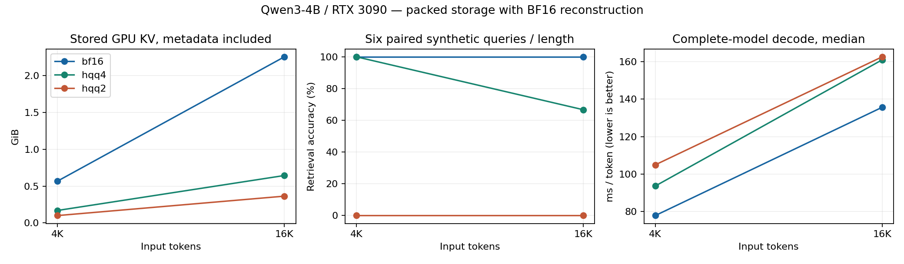
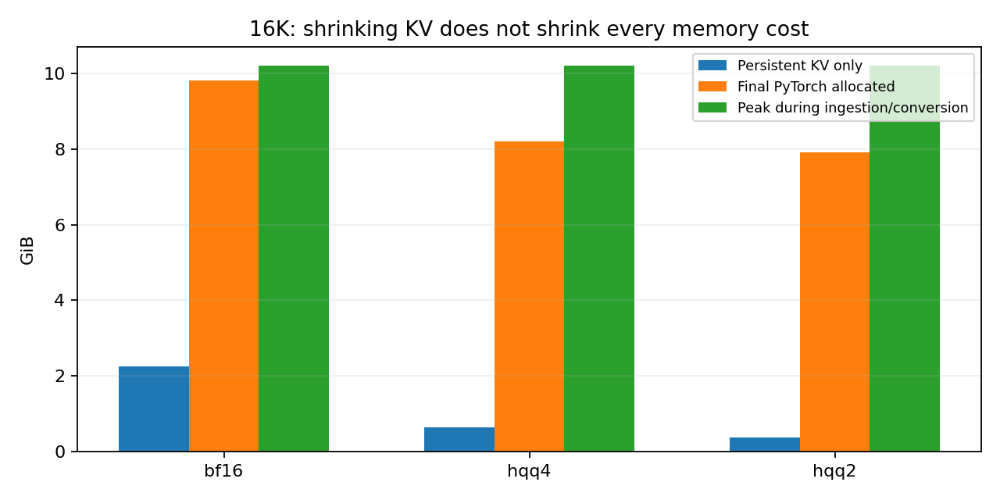

# Low-bit long-context memory: first measured baseline

Completed 2026-10-20. **This is an existing-method feasibility experiment, not a novel algorithm or an acceleration breakthrough.**

At 16K tokens, four-bit HQQ reduced stored KV by **3.50×**, but retrieved the correct code in **4/6** questions versus **6/6** for BF16 and took **1.19×** as long per decode token. Only **1/6** four-bit answers also obeyed the exact digits-only output format. The full results determine whether this implementation is useful; a smaller tensor alone does not establish that it is.

## What we did

We screened primary literature through October 20, 2026; installed an isolated package overlay without changing the earlier Mamba environment; downloaded and pinned Qwen3-4B; wrote the protocol before collecting the main sweep; ran three cache formats on 12 identical prompts (36 model runs); audited real packed storage and metadata; measured synchronized GPU execution and PyTorch allocation; and retained prompts, answers, raw metrics, source, and plots. A separate 4K smoke run guided a documented ingestion-memory amendment. We also ran 12 post-hoc eight-bit diagnostic cases.

The model has about four billion parameters. Its weights and activations stay BF16. We change only the historical attention cache. Every prompt contains a randomly generated six-digit target code among distracting records. We vary input length (4K, 16K), target position (10%, 50%, 90%), and two seeds. The same two target numbers repeat across positions/lengths, so these twelve cases are not twelve independent facts. The full model is used; this is not a standalone attention tensor simulation.

All methods ingest the document in BF16 chunks of 2,048 tokens. HQQ compresses history once at the document boundary. The final 64-token question suffix and generated answer then read the compressed history. This avoids the false test where the answer is computed before compression. The protocol amendment and original smoke measurements are retained.

## Results

| Context | Cache | Retrieved / 6 | Strict format / 6 | KV GiB | Effective bits | Decode ms/token | Total seconds |
|---|---|---:|---:|---:|---:|---:|---:|
| 4,096 | bf16 | 6 | 6 | 0.567 | 16.000 | 77.9 | 3.61 |
| 4,096 | hqq4 | 6 | 6 | 0.169 | 4.765 | 93.7 | 4.94 |
| 4,096 | hqq2 | 0 | 0 | 0.100 | 2.811 | 105.0 | 5.43 |
| 16,384 | bf16 | 6 | 6 | 2.254 | 16.000 | 135.7 | 9.64 |
| 16,384 | hqq4 | 4 | 1 | 0.643 | 4.567 | 161.0 | 13.07 |
| 16,384 | hqq2 | 0 | 0 | 0.363 | 2.578 | 162.6 | 13.49 |

Retrieval requires the first six-digit number in the answer to equal the target; strict format requires the entire stripped answer to equal those six digits. For example, one 16K four-bit answer contained the correct code with extra text and a stray closing thinking tag, while another changed target `709382` to `309382.`. We report both metrics rather than treating correct numbers embedded in format violations as perfect task execution. The retrieval figure uses the preregistered first-number metric.

Times are medians across six cases per context/method, after short warmups. Total is document ingestion + compression + question processing + a fixed 32-token generation workload; 31 further decode passes follow the first token produced by the question. Generation continues after EOS only to hold benchmark work fixed; quality scoring uses text before EOS. Total time is therefore **not** latency to an answer's natural stopping point. One timing observation per prompt, changing thermal state and concurrent computer activity limit precision. No statistically confirmed speedup or broad quality claim follows from this pilot.

## Where the bytes and time go

HQQ stores packed uint8 tensors containing two- or four-bit codes. Scale and zero-point tensors are BF16. Each 64-value group needs four metadata bytes, which adds 0.5 bits/value to the bulk representation. The 95-token uncompressed tail adds further overhead in this test. Thus the cache is not exactly 2 or 4 effective bits/value. We enumerate all cache tensor backing storages and deduplicate by device and pointer. Audited bytes exactly match an independent closed-form count for every recorded case. CPU/Python object overhead is excluded and separately distinguished from GPU storage.

The HF implementation dequantizes historical keys/values and concatenates BF16 tensors before ordinary SDPA attention. That creates extra reads, writes, launches, and temporary buffers. Source inspection establishes this implementation path; we have not yet measured DRAM traffic with a hardware profiler. It is **not** native INT4/FP4 arithmetic, a fused packed-cache attention kernel, or a faithful KIVI/TurboQuant reproduction. [Versioned HF source](https://github.com/huggingface/transformers/blob/v4.57.1/src/transformers/cache_utils.py).

Whole-model memory accounting at 16K (medians, GiB):

| Cache | Final allocated | Ingestion/conversion peak | Question/decode peak | Conversion seconds |
|---|---:|---:|---:|---:|
| bf16 | 9.81 | 10.20 | 10.69 | 0.00 |
| hqq4 | 8.20 | 10.20 | 9.14 | 2.62 |
| hqq2 | 7.92 | 10.20 | 8.86 | 3.00 |

Allocated memory includes model tensors, input tensors, and cache. It excludes CUDA reservation, driver/context overhead, and other processes, so it is not identical to nvidia-smi. Ingestion temporarily keeps the original BF16 cache for every format: the final cache compression ratio cannot be used to claim this pipeline supports proportionately longer prompts. Measured KV savings are also not a measured increase in concurrent requests; we did not run a serving scheduler.

For the 16K four-bit case, final allocated memory falls from 9.81 to 8.20 GiB, but the larger of ingestion and decode phase peaks falls only from 10.69 to 10.20 GiB (approximately 4.6% less). That is why final KV compression and usable peak-memory reduction need separate measurements.

## Exploratory eight-bit diagnostic

Added after observing failures in the 2/4-bit sweep. It uses the same 12 prompts, no tuned settings, and a separate run. Its sequential timing is not part of the rotated primary comparison. This is a diagnostic of precision sensitivity, not an independent quality confirmation. All 12 eight-bit answers retrieved the correct code and obeyed the strict output format. Timing was unstable: 4K decode ranged from 107.3 to 301.4 ms/token, and 16K from 155.5 to 376.1. We have not isolated the cause, so the medians below should not be treated as stable performance comparisons. The primary sweep had much less variation, but it too requires controlled independent timing replication.

| Context | Cache | Retrieved / 6 | Strict format / 6 | KV GiB | Effective bits | Decode ms/token | Total seconds |
|---|---|---:|---:|---:|---:|---:|---:|
| 4,096 | hqq8 | 6 | 6 | 0.307 | 8.673 | 295.6 | 15.03 |
| 16,384 | hqq8 | 6 | 6 | 1.204 | 8.543 | 157.0 | 11.57 |

## What is already published

Low-bit KV storage and asymmetric key/value quantization are established by [KIVI](https://arxiv.org/abs/2402.02750). Joint low-bit execution/cache system design is established by [QServe](https://arxiv.org/abs/2405.04532). Sensitivity-aware layer precision is covered by [KVTuner](https://arxiv.org/abs/2502.04420); query-aware channel precision by [MixKVQ](https://arxiv.org/abs/2512.19206); quantizer-specific bit allocation by [RateQuant](https://arxiv.org/abs/2605.06675). Rotation-based compression is covered by [TurboQuant](https://arxiv.org/abs/2504.19874).

Agent-structure allocation and real serving implementations are covered by [TriAxialKV](https://arxiv.org/abs/2605.17170) and [UltraQuant](https://arxiv.org/abs/2606.20474). Quantization plus self-speculation is covered by [QuantSpec](https://machinelearning.apple.com/research/quantspec). A very recent [ReadKV paper](https://arxiv.org/abs/2610.11245), submitted October 8, separates retained precision from query-dependent fetched precision. Its abstract describes a restricted single-layer latency evaluation; complete-serving benefits cannot be inferred from that number. These sources rule out calling the broad ideas new. The full source register records evidence status; we have not independently reproduced those papers' results.

## Research direction and next decisive result

The promising question is whether **page-aligned precision refinement and reuse can improve complete-model serving at fixed total memory and matched quality**. A possible mechanism would share an immutable progressive cache, retain a small bounded working set of useful refinements, and group page formats to avoid excessive GPU transactions and launch costs. ReadKV, prefix reuse, and tiered compression are close prior work. This is a candidate intersection, **not verified novelty**. The targeted search cannot certify no prior publication exists. Do not start by claiming a new quantizer or a new idea of query-dependent bits.

First reproduce an optimized packed-cache baseline, then measure whether refinement reuse offers headroom beyond ordinary decoded-page LRU. Only develop a new policy if the attainable benefit exceeds its extra memory, selection, and fetch costs. The present HQQ slowdown is a baseline diagnostic, not an explanation of every existing low-bit system's behavior. A faithful stronger baseline may eliminate the proposed advantage, which would be a reason to change direction.

The intended demonstration is two systems answering long-document or code questions under the same GPU budget while a dashboard shows useful requests completed on time, quality, tail latency, and peak memory. Success must be against a strong compressed-cache system, not only BF16. Suggested future targets are ≤1 percentage point absolute loss on each chosen task and ≥20% more deadline-qualified requests/second; these are **unmeasured research goals**. [NEXT_EXPERIMENT.md](NEXT_EXPERIMENT.md) specifies baselines, ablations, resource rationale, and stop conditions.

## How to explain this when presenting

“The model keeps a numerical notebook of the document so it does not have to reread everything from scratch for every word. I first checked whether reducing the notebook's precision preserved exact answers and actually made generation faster. I measured packed bytes, metadata, temporary memory, and complete-model timing. In this baseline, smaller stored history did not translate into faster decoding, and aggressive compression damaged retrieval. The next research step is a reader and memory policy that improves useful serving throughput over strong existing methods.”

Be precise about scope: a transformer cache is context-sized attention memory, not the fixed-size recurrent state from our earlier project. Easy synthetic lookup is a sanity check; it does not establish reasoning, code accuracy, multi-turn robustness, or general long-context capability. We have no trained new method, no optimized fused implementation, and no publishable novelty claim yet. Those are the next scientific and engineering requirements, not details that the presentation can omit.

## Reproduction and evidence

Model: Qwen/Qwen3-4B revision `1cfa9a7208912126459214e8b04321603b3df60c`; torch 2.8.0+cu128, Transformers 4.57.1, HQQ 0.2.8.post1, one RTX 3090. BF16 weights, SDPA, TF32 disabled, no thinking, deterministic greedy tokens. Model weights remain local and are excluded from the delivery archive. Requirements and model-file SHA256 manifest accompany the package. See [README.md](README.md) for commands.

Raw main evidence: `raw_results.jsonl`, `prompts.json`, `results.csv`, `summary.json`, `environment.json`; separate exploratory evidence: `smoke.jsonl`, `raw_diagnostic8.jsonl`, `environment_diagnostic8.json`. Every answer, including failures, is retained. `PROTOCOL.md` records the design and amendments. `sources.json` records the literature screen. `validation.json` records integrity checks, not an independent replication.
