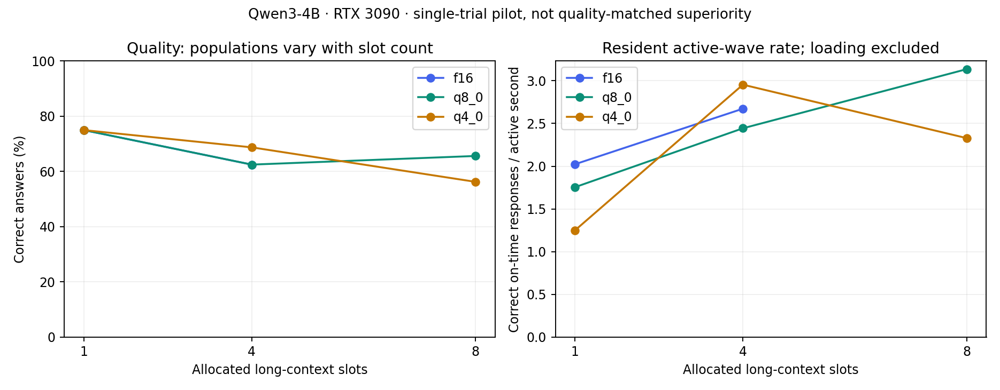

# E004 GPU serving pilot — 2026-10-22

**The packed-cache engine loaded eight long contexts with Q8 and Q4, but this pilot does not establish improved quality-matched response throughput.** These are stock-engine baseline measurements, not a new reader or FPGA accelerator.

## Resident contexts

| KV | Slots | Correct / requests | Deadline-qualified | Active-wave rate (responses/s) | KV allocated (GiB) | Load time (s) |
|---|---:|---:|---:|---:|---:|---:|
| f16 | 1 | 3/4 | 3 | 2.024 | 2.391 | 3.52 |
| q8_0 | 1 | 3/4 | 3 | 1.755 | 1.270 | 3.75 |
| q4_0 | 1 | 3/4 | 3 | 1.250 | 0.672 | 3.72 |
| f16 | 4 | 10/16 | 10 | 2.673 | 9.562 | 14.25 |
| q8_0 | 4 | 10/16 | 10 | 2.444 | 5.080 | 11.25 |
| q4_0 | 4 | 11/16 | 11 | 2.955 | 2.689 | 14.97 |
| q8_0 | 8 | 21/32 | 21 | 3.136 | 10.160 | 26.06 |
| q4_0 | 8 | 18/32 | 18 | 2.329 | 5.379 | 15.01 |

Resident rate excludes context loading and inter-wave gaps. Different slot counts use different client populations; compare the same-slot controls before interpreting a capacity curve. All 124 selected resident questions reused the document prefix according to `timings.cache_n`.

## Identical cold burst

| KV | Slots | Correct / 8 | Deadline-qualified / 8 | Burst time (s) | Median TTFT (s) |
|---|---:|---:|---:|---:|---:|
| f16 | 1 | 4/8 | 3/8 | 31.18 | 17.77 |
| q8_0 | 1 | 4/8 | 1/8 | 33.30 | 19.01 |
| q4_0 | 1 | 4/8 | 2/8 | 32.59 | 18.21 |
| f16 | 4 | 4/8 | 0/8 | 31.10 | 17.07 |
| q8_0 | 4 | 4/8 | 0/8 | 33.42 | 18.13 |
| q4_0 | 4 | 4/8 | 0/8 | 33.07 | 17.66 |
| q8_0 | 8 | 4/8 | 0/8 | 33.49 | 17.42 |
| q4_0 | 8 | 4/8 | 0/8 | 33.24 | 17.79 |

Every format faces the same eight cold requests; queueing/prefill is included. No correct responses met all three deadlines at four or eight slots. Some early correct responses met the first-token limit but stalled between tokens while other documents were ingested. Scheduling/prefill interference warrants a separate controlled test; this pilot does not isolate its cause.

## Interpretation and next steps

- All slots have 17,408 tokens of capacity; inputs are approximately 16K and outputs stop naturally at EOS. Weights, engine, inputs and deadlines are fixed across formats.
- Multi-record extraction is difficult even for F16. Report task-level quality and use held-out RULER/multi-hop/code tasks before making a quality-preservation claim. Compression cannot be blamed for every baseline failure.
- At equal slot count the plain Q4/Q8 paths do not show a reliable useful-rate win over F16 in this one trial. Eight-slot compressed runs show device-resident KV capacity; that alone is not throughput superiority.
- F16 with eight slots needs approximately 26.6 GiB for the conservative weight proxy plus KV, exceeding initial free device memory before scratch. It was guarded out, not run to OOM. Actual Q8/Q4 allocation is verified in startup logs.
- Native logs report CUDA_Host model/output/compute buffers in addition to CUDA0 allocations. We verified reported layer offload and GPU KV, not that every operation or parameter access is GPU-only. No physical-byte/kernel-counter measurement was made.
- Collect repeated trials, a stronger quality set, open-loop arrivals and a tuned serving baseline. Then use P001/P002 to test a specific improvement; do not claim novelty for this comparison.

## Integrity and recovery

Q8 c8 uses a new complete rerun because the original run lost its final wave/configuration snapshots after a Windows write error. Original raw rows are retained, not silently replaced.
Resident rate divides qualified responses by the sum of four active wave durations; it excludes initial loading and orchestration gaps. It is not steady-state or identical-arrival serving throughput.
Populations differ by slot count. Single timing trial and eight independent documents cannot establish matched-quality noninferiority or a general speedup.
F16 c8 was not executed because of an analytical allocation guard, not an observed OOM.
Startup logs verify 37/37 reported repeating/output layers offloaded, CUDA0 KV types/allocation and enabled Flash Attention. CUDA_Host buffers also exist. No kernel-dispatch or physical DRAM counter profile was collected.

Selected: 188 scored requests across eight configurations; 267 raw rows including loads and the retained duplicate Q8 run; 212 analysis assertions passed.

The failed original CLI smoke and the three older timing-client smoke rows remain archived and are excluded. See [protocol amendment](AMENDMENT-2026-10-22.md), [raw pilot](raw_research_pilot_20261022.jsonl), [recovery raw](raw_research_recovery_20261022.jsonl), [CSV](serving_summary.csv) and [summary JSON](serving_summary.json).

